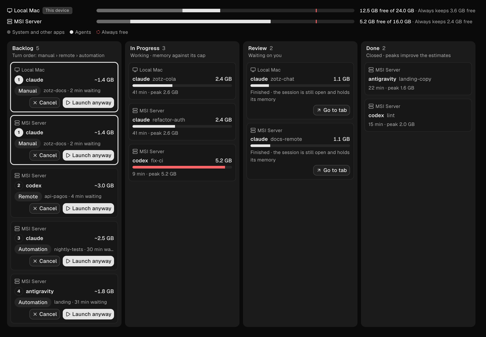
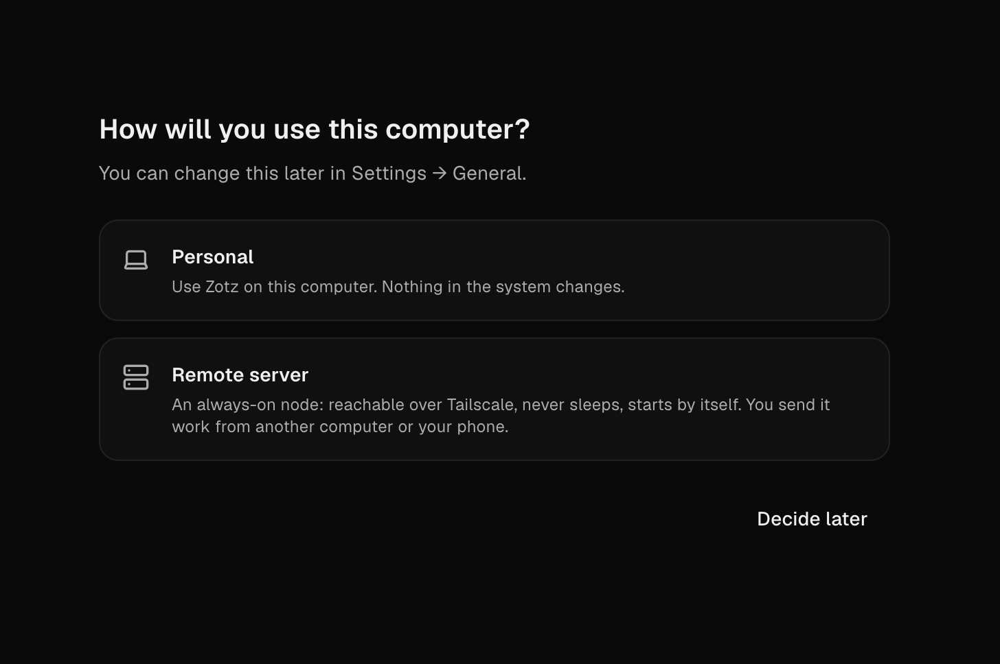
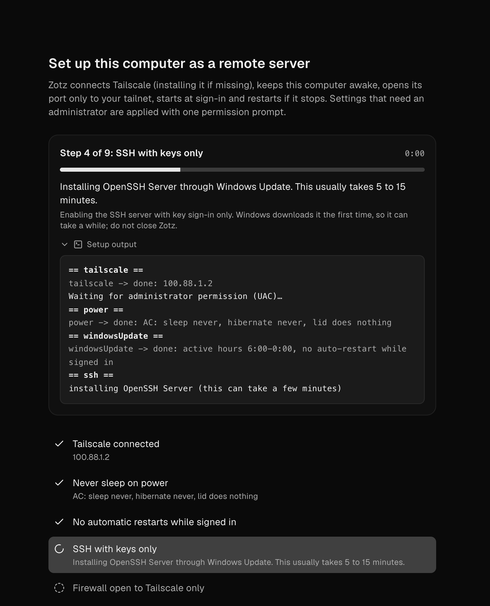

<h1 align="center">
   Zotz
</h1>

  
  
  

  <strong>Un nodo de agentes que trabaja de noche.</strong> 
  Corre Claude Code, Codex y Antigravity en paralelo, cada uno en su propio worktree, en una máquina encendida 24/7 a la que le mandas tareas por Tailscale desde tu laptop o tu celular.

<h3 align="center"><a href="https://github.com/HugoRodriguezDEV/zotz/releases/latest"><ins>Descargar Zotz</ins></a></h3>

  

> _Zotz_ es "murciélago" en maya: trabaja de noche y se orienta solo en la oscuridad.

## Qué hace Zotz

- **Nodo remoto 24/7**: en modo servidor, la máquina no se duerme, Zotz arranca al iniciar sesión y se reinicia solo si se cae. Un asistente lo configura todo con un solo permiso de administrador ([guía](docs/zotz/guias/NODE-SETUP.md)).
- **Acceso solo por Tailscale**: el nodo acepta conexiones de la propia máquina y de tu tailnet; la red local e internet quedan fuera ([guía](docs/zotz/guias/REMOTE.md)).
- **Agentes con acceso total**: Claude Code, Codex y Antigravity arrancan en full-access, sin pedir aprobaciones. Los demás agentes siguen disponibles, ocultos por defecto.
- **Gobernador de memoria**: antes de lanzar un agente revisa la memoria libre; si no alcanza, lo pone en cola. Un tablero lateral muestra la cola de cada máquina.
- **Cero telemetría**: no manda eventos de uso. Relay, inicio de sesión, compartir y el catálogo de plugins remoto vienen apagados.
- **Actualizaciones controladas**: se actualiza desde los releases de este repo, descarga en segundo plano y nunca se reinicia a media tarea; en modo servidor espera a que no haya agentes corriendo ([detalles](docs/zotz/guias/UPDATE.md)).

<table>
<tr>
<td width="50%"></td>
<td width="50%"></td>
</tr>
<tr>
<td>Al primer arranque eliges si la máquina es personal o un servidor remoto.</td>
<td>En modo servidor, Zotz configura la máquina paso a paso y muestra qué hace.</td>
</tr>
</table>

## Lo que trae de base

- **Chat o terminal**: corre cualquier agente en la UI de chat o como CLI y mueve la conversación entre ambos sin perder contexto.
- **Orquestar agentes**: un agente divide una tarea grande, lanza workers en sus propios workspaces y te trae los resultados.
- **Worktrees en paralelo**: varios agentes trabajan lado a lado sin pisarse.
- **Revisar lo que hace la IA**: diffs, notas en líneas exactas y feedback directo al agente.
- **Integración con Git**: commits y PRs redactados desde el diff; checks fallidos y comentarios de review de vuelta al agente.
- **Navegador integrado y modo diseño**: haz clic en cualquier elemento para copiar su HTML, estilos y selector al chat del agente.
- **Tareas de GitHub y Linear** en un solo lugar, con un workspace por tarea.
- **Paneles divididos**: agentes, terminales, navegador y diffs lado a lado.
- **CLI `zotz`**: lo que haces en la app, tus agentes lo pueden hacer desde la línea de comandos: crear worktrees, lanzar workers, manejar el navegador y programar automatizaciones.
- **Automatizaciones, dictado, vistas previas** de imágenes/PDF/Markdown, **emulador móvil** y **computer use** para apps de escritorio sin CLI.

---

## Instalar

Descarga la versión más reciente desde [Releases](https://github.com/HugoRodriguezDEV/zotz/releases/latest):

- [macOS Apple Silicon (.dmg)](https://github.com/HugoRodriguezDEV/zotz/releases/latest/download/zotz-macos-arm64.dmg)
- [Windows (.exe)](https://github.com/HugoRodriguezDEV/zotz/releases/latest/download/zotz-windows-x64-setup.exe)
- [Linux AppImage](https://github.com/HugoRodriguezDEV/zotz/releases/latest/download/zotz-linux-x64.AppImage) · [Linux .deb](https://github.com/HugoRodriguezDEV/zotz/releases/latest/download/zotz-linux-amd64.deb)

Notas:

- **Windows**: el instalador no está firmado; SmartScreen avisará la primera vez.
- **macOS**: el build no tiene Developer ID, así que las versiones nuevas se instalan a mano desde el `.dmg` (la app avisa cuando hay una).

La primera vez que abres Zotz te pregunta si la máquina es **personal** o **servidor remoto**. Para preparar un nodo, sigue [NODE-SETUP.md](docs/zotz/guias/NODE-SETUP.md).

---

## Desarrollo

- Plan de trabajo y reglas del proyecto: [docs/zotz/PLAN.md](docs/zotz/PLAN.md)
- Cómo correr y contribuir: [CONTRIBUTING.md](.github/CONTRIBUTING.md)
- Seguridad del nodo: [docs/zotz/guias/SECURITY.md](docs/zotz/guias/SECURITY.md)

## Licencia

Zotz es software libre bajo la [licencia MIT](LICENSE). Parte del código de un proyecto MIT de StablyAI; su aviso de copyright se conserva en [LICENSE](LICENSE).
